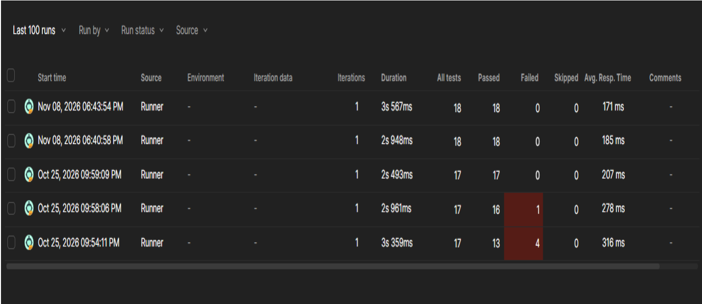

# API Test Report – JSONPlaceholder

**Tester:** Dávid Árvai
**Date:** 2026-11-08
**Tool:** Postman (collection runner)
**Target:** https://jsonplaceholder.typicode.com (public fake REST API)
**Scope:** CRUD operations, filtering, negative scenario, persistence check

## Summary

8 requests, 18 automated checks, all passing in the final run.
The collection export and run screenshots are included in this repository.

## Test cases

| ID | Test | Steps | Expected | Actual | Result |
|----|------|-------|----------|--------|--------|
| TC-01 | List all posts | GET /posts | 200, JSON, 100 items, response < 1000 ms | As expected | Pass |
| TC-02 | Get single post | GET /posts/1 | 200, id = 1, fields: userId, id, title, body | As expected | Pass |
| TC-03 | Filter posts by user | GET /posts?userId=1 | 200, 10 posts, all with userId = 1 | As expected | Pass |
| TC-04 | Create post | POST /posts with JSON body | 201, title echoed back, id returned | 201, id = 101 | Pass |
| TC-05 | Update post | PUT /posts/1 with JSON body | 200, updated title in response | As expected | Pass |
| TC-06 | Delete post | DELETE /posts/1 | 200 | 200, empty body | Pass |
| TC-07 | Non-existent resource | GET /posts/9999 | 404 | 404 | Pass |
| TC-08 | Persistence after create | GET /posts/101 (after TC-04) | 200 with the new post (as on a real API) | 404 | Observation |

TC-07 and TC-08 return 404 by design; the tests expect this status.

## Findings

**1. Writes are not persisted (by design).**
POST /posts returns 201 and a new id (101), but GET /posts/101 afterwards returns 404.
According to the JSONPlaceholder documentation, write operations are faked: the server responds as if the change happened, but nothing is saved. This is expected for a demo API, so I recorded it as an observation, not a defect.

**2. What I would do on a real API.**
- After POST, send a GET with the returned id and compare every field with what was sent.
- After PUT, GET the resource and verify the changed fields.
- After DELETE, GET the resource and expect 404.
- Clean up test data and run against a test environment, never production.

**3. Limitations of this test set.**
- No authentication tests (the API is public).
- Response checks cover status codes and field names only; no full JSON schema validation.
- No invalid-payload tests (missing fields, wrong types). The API accepts almost any body, so these would not be meaningful here.

**4. Next steps.**
Add JSON schema validation, run the collection from the command line with Newman, and run it automatically in GitHub Actions.

**5. Lesson learned.**
During my first runs several checks failed because of mistakes in my own test setup (a missing request body in the PUT request and a wrong URL in the DELETE request), not because of the API. I fixed the setup and re-ran until all checks passed. It reminded me to separate test errors from product defects before reporting a bug.

